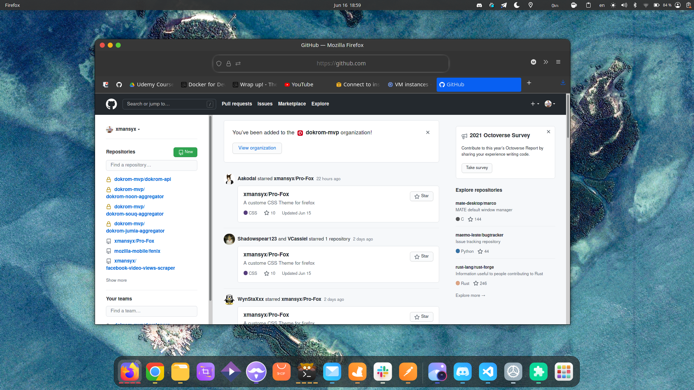
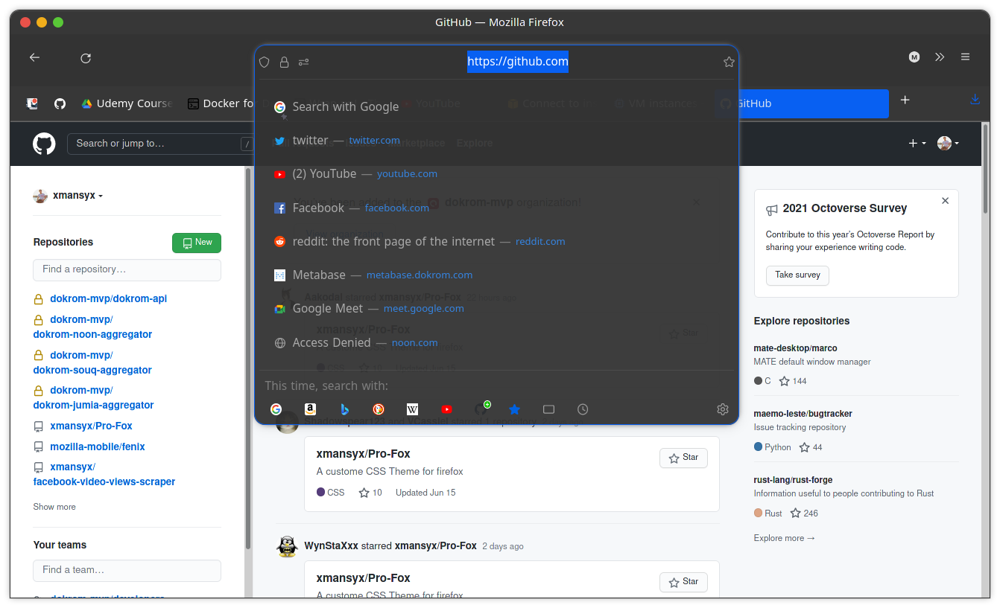
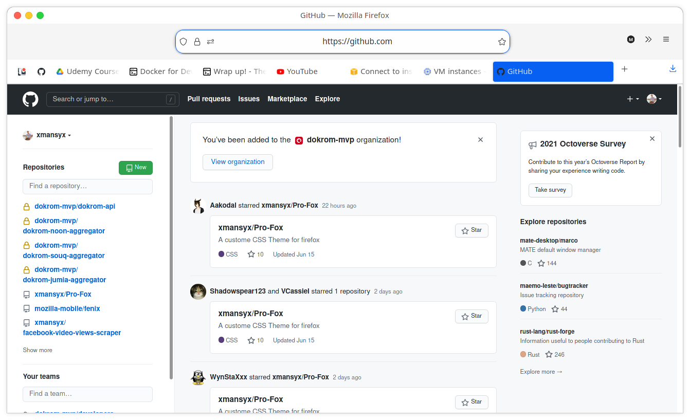
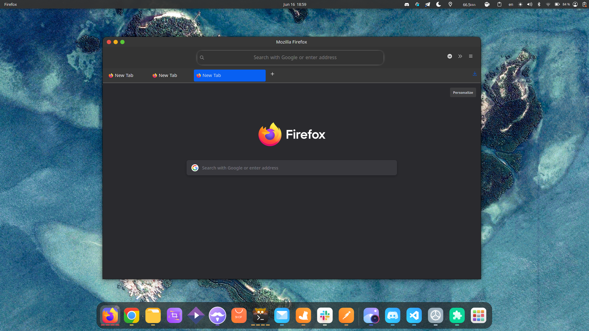
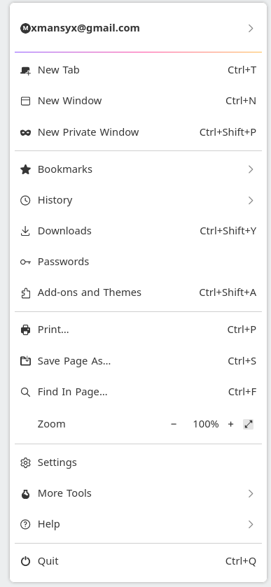
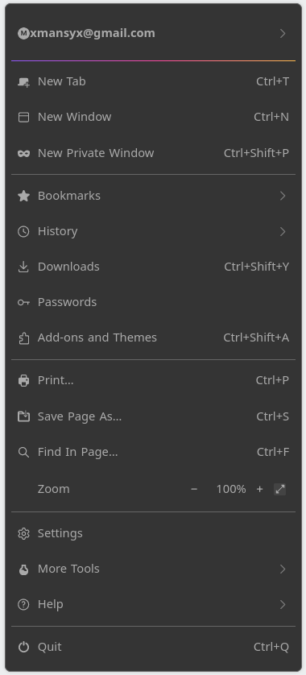
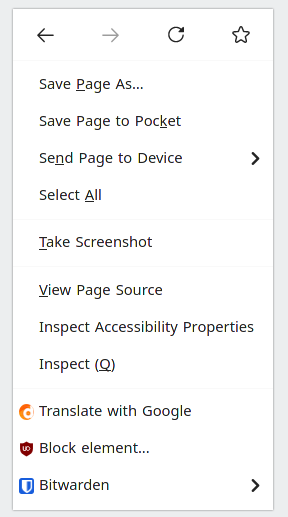
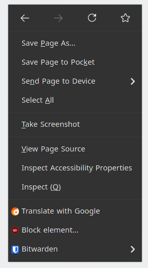
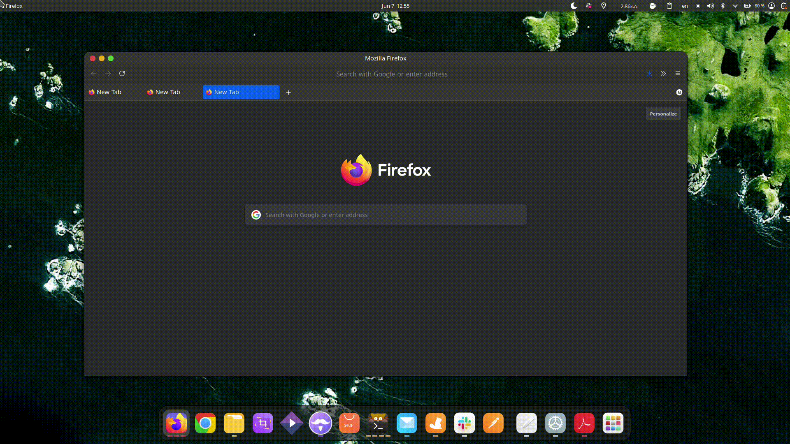

# pro-fox: A Firefox Theme

## Description
A custom CSS theme for Firefox Proton that aims to make it even better
+ tabs are moved under the URL bar
+ centered URL bar
+ remove (playing - paused) from tabs that are playing videos or sound
+ selected tabs expand and use the system accent color
+ moved sound icon on top of favicon
+ enhanced and bigger menus with icons
+ supports both dark and light mode
+ more...

### Notes
+ Developed and tested on Linux.
+ Windows and macOS window controls are handled with `-moz-platform` media queries.
+ Firefox changes its internal UI often, so a Firefox update can break parts of any `userChrome.css` theme. Please open an issue with your Firefox version if something looks wrong.

### Manual Installation

1. Open `about:config` page.
2. Press the `Accept the Risk and Continue` button.
3. Set these preferences to `true`:

	+ **`toolkit.legacyUserProfileCustomizations.stylesheets`** (lets Firefox load `userChrome.css`)
	+ **`svg.context-properties.content.enabled`** (lets the menu icons follow the theme color)

4. Open your Firefox profile folder: go to `about:support` and click **Open Folder** next to **Profile Folder**.

	+ Linux - `$HOME/.mozilla/firefox/XXXXXXX.default-XXXXXX/`
	+ Windows - `C:\Users\<USERNAME>\AppData\Roaming\Mozilla\Firefox\Profiles\XXXXXXX.default-XXXXXX`
	+ macOS - `/Users/<USERNAME>/Library/Application Support/Firefox/Profiles/XXXXXXX.default-XXXXXXX`

5. Create a folder named **`chrome`** in the profile folder and copy `userChrome.css` from this repo into it.
6. Restart Firefox.
7. Pick a color mode in **Settings → General → Website appearance**, or choose a theme in **Add-ons and themes**:

	+ System theme - follows your OS colors with this theme's layout.
	+ Dark - dark color scheme. Good for the night.
	+ Light - bright color scheme.
